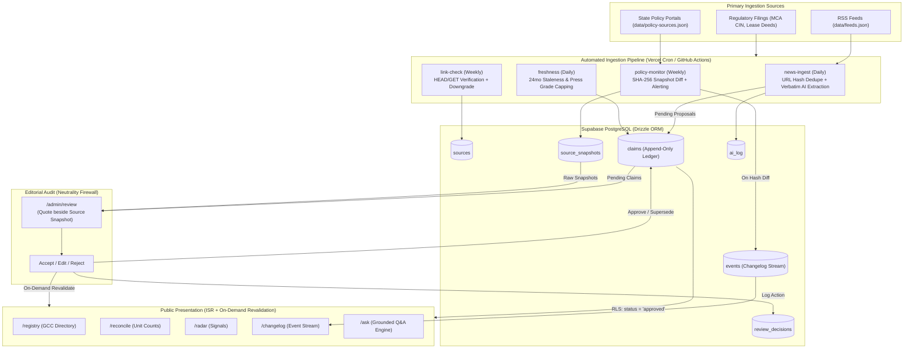

# ZeroDay — Grounded Intelligence Platform & Capability Centre Ledger

ZeroDay is the independent, citable record of India's Global Capability Centre (GCC) ecosystem. Every figure, headcount, and real estate absorption metric is anchored to an immutable primary statutory filing, registered lease deed, or gazetted government order.

---

## 🏗️ Architecture & Data Flow



---

## 📦 Database & Drizzle Schema

ZeroDay uses **Supabase PostgreSQL** with **Drizzle ORM**.
The schema enforces strict append-only semantics for factual claims and Row Level Security (RLS) to ensure that public queries can read only approved records.

### Core Tables
1. **`sources`**: Authoritative registry of primary filings, press, and state gazettes.
2. **`source_snapshots`**: Verbatim document text with cryptographic SHA-256 `content_hash` and `fetched_at` timestamp.
3. **`claims`**: Immutable append-only ledger (`subject_type`, `subject_id`, `field`, `value`, `unit`, `as_of`, `source_id`, `confidence`, `status`, `valid_from`, `valid_to`, `last_checked_at`, `created_by`).
4. **`entities`**: GCCs, cities, states, and service providers.
5. **`signals`**: Expansion, lease, or incorporation events.
6. **`proof_links`**: Evidentiary links connecting providers to GCCs.
7. **`events`**: System changelog stream (new GCCs, changed claims, policy updates, staleness downgrades).
8. **`ai_log`**: Audit log of verbatim AI parser executions.
9. **`review_decisions`**: Human-in-the-loop audit log of accept, edit, and reject actions.
10. **`cron_job_runs`**: Telemetry and idempotency tracking for pipeline executions.

---

## 🔁 Append-Only Claim Lifecycle

When a claim value changes (e.g., via administrative review or updated regulatory filing):
1. The existing active claim is closed:
   - `valid_to = NOW()`
   - `status = 'superseded'`
2. A new claim is inserted:
   - `valid_from = NOW()`
   - `valid_to = NULL`
   - `status = 'approved'`
3. Complete history remains queryable via `claimsRepo.getHistory(subjectType, subjectId, field)` or direct PostgreSQL query ordered by `valid_from DESC`.
4. Public queries (`claimsRepo.getAll()`) automatically filter out superseded, pending, and rejected claims.

---

## 🚀 How to Run Jobs Locally

You can execute any of the background pipeline jobs locally using `tsx`:

```bash
# 1. Run News Ingestion (RSS fetch, URL dedupe, verbatim AI extraction)
npx tsx scripts/jobs/run-job.ts news-ingest

# 2. Run Policy Monitor (State policy URL fetch, SHA-256 snapshot hashing, diff detection)
npx tsx scripts/jobs/run-job.ts policy-monitor

# 3. Run Link Checker (HEAD/GET probe, dead link detection, confidence downgrade)
npx tsx scripts/jobs/run-job.ts link-check

# 4. Run Freshness Audit (24-month staleness rules, single press Grade C capping)
npx tsx scripts/jobs/run-job.ts freshness
```

---

## ➕ How to Add a New Source or Feed

### Adding an RSS Feed
Add a new feed entry to `data/feeds.json`:

```json
{
  "id": "feed-custom-source",
  "name": "Custom Technology Bulletin",
  "url": "https://example.com/rss/gcc-news.xml",
  "category": "press",
  "enabled": true
}
```

### Adding a State Policy Monitor
Add a new policy entry to `data/policy-sources.json`:

```json
{
  "id": "policy-ap-gcc-2026",
  "state_id": "state-ap",
  "state_name": "Andhra Pradesh",
  "policy_name": "Andhra Pradesh Capability Centre Framework",
  "url": "https://it.ap.gov.in/policies/gcc-framework",
  "publisher": "Information Technology Department, Government of Andhra Pradesh",
  "check_interval": "weekly",
  "enabled": true
}
```

### Adding a Primary Source Document
Insert into `data/sources.json` or through the administrative portal:

```json
{
  "id": "src-roc-ka-2026-091",
  "name": "Ministry of Corporate Affairs RoC Bangalore Filing",
  "type": "government",
  "url": "https://www.mca.gov.in/mcafoportal/companyLLPMasterData.do",
  "publisher": "Ministry of Corporate Affairs",
  "published_at": "2026-02-14",
  "retrieved_at": "2026-10-23"
}
```

---

## 🛡️ Security & Robots.txt Compliance

1. **Polite Fetcher**: Strictly respects `robots.txt` Disallow directives.
2. **Contact User-Agent**: Every request sends:
   ```
   User-Agent: ZeroDay-Bot/1.0 (+https://zeroday.in/bot; contact@zeroday.in)
   ```
3. **Domain Rate Limiting**: Enforces a minimum 1000ms delay between consecutive requests to the same origin.
4. **No Gated Scraping**: Strictly prohibits and blocks crawling of LinkedIn, Facebook, Glassdoor, and other gated or login-wall platforms.
5. **Row Level Security (RLS)**: Public client database tokens are restricted to `status = 'approved'` claims.

---

## 🧪 Testing & Verification

Run the full Vitest suite:

```bash
npm test
```

The test suite validates:
- `tests/claim-supersession.test.ts`: Append-only closure of old rows and insertion of new approved rows.
- `tests/hash-change-detection.test.ts`: SHA-256 diffing and change detection.
- `tests/staleness.test.ts`: 24-month staleness downgrade and press capping rules.
- `tests/pipeline-integration.test.ts`: End-to-end integration proving policy updates create events and pending claims, and remain invisible publicly until human-in-the-loop review approves them.

---

## 💻 Local Development

```bash
# Install dependencies
npm install

# Run migration script
npx tsx scripts/migrate-to-postgres.ts

# Start Next.js local server
npm run dev
```

Visit [http://localhost:3000](http://localhost:3000) to view the dark-mode ZeroDay platform.
Visit [http://localhost:3000/admin/review](http://localhost:3000/admin/review) for the human-in-the-loop review queue.
Visit [http://localhost:3000/changelog](http://localhost:3000/changelog) for the live public event stream.
